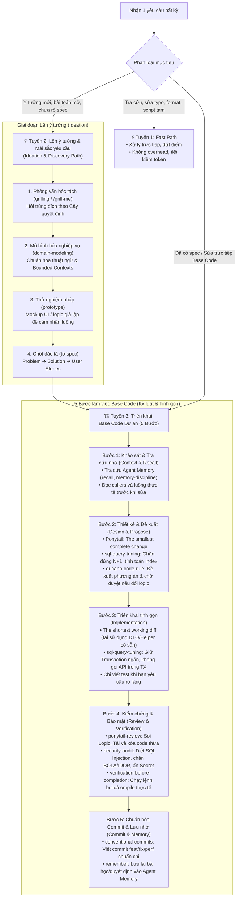

# AI-Skill-List

Danh mục skill và công cụ mở rộng (MCP) dùng cho các AI coding agent (Codex, Antigravity/Gemini, Claude Code, Cursor...). Repo lưu **skill tự tạo & tối ưu riêng** trong `skills/`; skill từ dự án khác chỉ có link nguồn và hướng dẫn cài, không dùng submodule hay sao chép cả repo bên ngoài.

---

## 1. Skill tự tạo & Tối ưu hóa nội bộ

| Skill | Nội dung | Tệp chính |
|---|---|---|
| `project-coding-workflow` | Luồng làm việc chuẩn hóa toàn diện từ lúc **lên ý tưởng** đến **viết base code**: 3 tuyến xử lý (Fast Path, Ideation & Discovery, Base Code 5 bước). Kết hợp tinh hoa ECC, Ponytail và các skill cốt lõi. | [SKILL.md](skills/project-coding-workflow/SKILL.md) |
| `ducanh-code-rule` | Viết, sửa và refactor Java theo project hiện tại; rà code để tái sử dụng trước khi tạo hàm chung mới, giữ code đơn giản, dễ mở rộng và package đúng trách nhiệm. Chỉ thêm test khi người dùng yêu cầu rõ ràng. | [SKILL.md](skills/ducanh-code-rule/SKILL.md) |
| `sql-query-tuning` | Tối ưu hóa Database & SQL (lấy cảm hứng từ ECC `database-reviewer`): Diệt triệt để N+1 queries, tối ưu hóa Indexing (Leftmost Prefix, Covering Index), Keyset pagination, tối giản Transaction. | [SKILL.md](skills/sql-query-tuning/SKILL.md) |
| `security-audit` | Rà soát bảo mật & quét lỗ hổng theo chuẩn OWASP Top 10 và ECC AgentShield: Diệt SQL Injection, chống BOLA/IDOR (truy cập trái phép đối tượng), ngăn lộ lọt Secret/Credential, che mờ log dữ liệu nhạy cảm. | [SKILL.md](skills/security-audit/SKILL.md) |
| `conventional-commits` | Quy chuẩn viết Git Commit Message theo chuẩn Conventional Commits 1.0.0 (`feat:`, `fix:`, `refactor:`, `perf:`, `chore:`...), cam kết commit nguyên tử (Atomic Commit), thể mệnh lệnh. | [SKILL.md](skills/conventional-commits/SKILL.md) |

---

### Cài đặt Skill tự tạo bằng Skills CLI

Cần Node.js/npm để chạy `npx`. Cài trực tiếp từ repo này cho Codex hoặc Antigravity:

```bash
# Cài lẻ từng skill
npx skills add nonamcabibaranani-design/AI-Skill-List --skill project-coding-workflow -a codex -g
npx skills add nonamcabibaranani-design/AI-Skill-List --skill sql-query-tuning -a codex -g
npx skills add nonamcabibaranani-design/AI-Skill-List --skill security-audit -a codex -g
npx skills add nonamcabibaranani-design/AI-Skill-List --skill conventional-commits -a codex -g
npx skills add nonamcabibaranani-design/AI-Skill-List --skill ducanh-code-rule -a codex -g
```

> **Mẹo:** Thay `-a codex` bằng `-a antigravity` (hoặc `-a claude-code`, `-a cursor`). Bỏ `-g` nếu chỉ muốn cài riêng trong phạm vi project hiện tại.

Nếu muốn cài từ mã nguồn local đã clone về máy:

```bash
git clone https://github.com/nonamcabibaranani-design/AI-Skill-List.git
cd AI-Skill-List
npx skills add . --skill project-coding-workflow -a codex -g
```

---

## 2. Quy trình chuẩn khi làm việc với Code Dự án (Project Coding Workflow)

Quy trình này giải quyết bài toán cốt lõi của lập trình AI: **Nhanh gọn khi cần nhưng cực kỳ kỷ luật khi đụng vào Base Code**, kết hợp tính chặt chẽ của ECC với triết lý tối giản của Ponytail.



### Chi tiết 3 Tuyến:

1. **⚡ Tuyến 1: Fast Path (Tuyến nhanh)**
   * Dành cho: Tra cứu cú pháp, sửa typo, format, script tạm.
   * Xử lý ngay lập tức, không qua các bước thủ tục để tối ưu tốc độ và chi phí token.

2. **💡 Tuyến 2: Lên ý tưởng & Mài sắc yêu cầu (Ideation & Discovery)**
   * Áp dụng khi yêu cầu còn sơ khởi, mở, cần bàn bạc giải pháp kiến trúc.
   * Dùng [`grilling`](#skill-từ-nguồn-bên-ngoài) để bóc tách cây quyết định, [`domain-modeling`](#skill-từ-nguồn-bên-ngoài) thống nhất thực thể/thuật ngữ, [`prototype`](#skill-từ-nguồn-bên-ngoài) thử nghiệm cảm giác dùng, và [`to-spec`](#skill-từ-nguồn-bên-ngoài) chốt lại bài toán.

3. **🏗️ Tuyến 3: Triển khai Base Code Dự án (5 Bước)**
   * **Bước 1 (Recall):** Đọc Agent Memory và khảo sát luồng dữ liệu trước khi sửa.
   * **Bước 2 (Design & Propose):** Lùng sục code tái sử dụng (`ponytail`), tối ưu hóa query từ đầu (`sql-query-tuning`), đề xuất phương án và chờ phê duyệt nếu thay đổi logic (`ducanh-code-rule`).
   * **Bước 3 (Implementation):** Chọn phương án ngắn gọn nhất (`shortest working diff`), package đúng trách nhiệm, chỉ thêm test khi có yêu cầu rõ ràng.
   * **Bước 4 (Review & Verification):** Rà soát an toàn (`security-audit`), kiểm tra tải và code thừa (`ponytail-review`), chạy lệnh build/compile thực tế (`verification-before-completion`).
   * **Bước 5 (Commit & Remember):** Soạn Git commit message chuẩn quốc tế (`conventional-commits`), lưu bài học/quyết định vào Agent Memory (`remember`).

---

## 3. Skill & Công cụ từ nguồn bên ngoài

Chọn nguồn và skill cần dùng rồi cài trực tiếp từ upstream. Các link dưới đây dẫn tới tài liệu chính chủ để theo dõi cách cài và cập nhật của từng dự án:

| Nguồn | Skill tiêu biểu | Hướng dẫn cài chính chủ |
|---|---|---|
| [ECC (Everything Claude Code)](https://github.com/affaan-m/everything-claude-code) | Kho tham khảo mẫu: `database-reviewer`, `security-review`, `backend-patterns` | [README](https://github.com/affaan-m/everything-claude-code#readme) |
| [ponytail](https://github.com/DietrichGebert/ponytail) | `ponytail`, `ponytail-audit`, `ponytail-debt`, `ponytail-review` (Triết lý Lazy Senior Dev) | [README](https://github.com/DietrichGebert/ponytail#readme) |
| [superpowers](https://github.com/obra/superpowers) | `brainstorming`, `systematic-debugging`, `test-driven-development` | [README](https://github.com/obra/superpowers#readme) · [Cài cho Codex](https://github.com/obra/superpowers/blob/main/.codex/INSTALL.md) |
| [Matt Pocock Skills](https://github.com/mattpocock/skills) | `domain-modeling`, `to-spec`, `grilling`, `code-review`, `retro` | [Hướng dẫn chính chủ](https://github.com/mattpocock/skills#readme) |
| [Agent Memory](https://github.com/rohitg00/agentmemory) | Bộ nhớ lâu dài qua MCP: `memory-discipline`, `recall`, `remember`, `forget` | [Cài dịch vụ](https://github.com/rohitg00/agentmemory#install) · [Kết nối agent](https://github.com/rohitg00/agentmemory#other-agents) |
| [Context7](https://context7.com) | Tra cứu tài liệu và code example mới nhất theo phiên bản qua MCP (giảm hallucination) | [Tài liệu chính chủ](https://context7.com) |
| [Chrome DevTools MCP](https://github.com/ChromeDevTools/devtools-mcp) | MCP Server kết nối Chrome DevTools: inspect DOM, console logs, network cho Web/Frontend | [README](https://github.com/ChromeDevTools/devtools-mcp#readme) |
| [Playwright MCP](https://github.com/microsoft/playwright) | MCP Server tự động hóa browser: test E2E user flows, tương tác UI tự động | [Tài liệu npm](https://www.npmjs.com/package/@playwright/mcp) |
| [impeccable](https://github.com/pbakaus/impeccable) | Thiết kế, review và cải thiện giao diện frontend | [README](https://github.com/pbakaus/impeccable#readme) |
| [graphify](https://github.com/Graphify-Labs/graphify) | Biến codebase, docs, schema thành knowledge graph (`/graphify`) | [README](https://github.com/Graphify-Labs/graphify#readme) |
| [caveman](https://github.com/JuliusBrussee/caveman) | `caveman`, `caveman-commit`, `caveman-compress` | [README](https://github.com/JuliusBrussee/caveman#readme) |
| [vercel-skills](https://github.com/vercel-labs/skills) | `find-skills`; CLI khám phá và cài skill | [README](https://github.com/vercel-labs/skills#readme) |

---

### Cài từng skill bên ngoài bằng Skills CLI

Liệt kê trước khi chọn:

```bash
npx skills add DietrichGebert/ponytail --list
npx skills add obra/superpowers --list
npx skills add mattpocock/skills --list
```

Ví dụ cài cho Codex hoặc Antigravity:

```bash
npx skills add DietrichGebert/ponytail --skill ponytail -a codex -g
npx skills add obra/superpowers --skill systematic-debugging -a codex -g
npx skills add mattpocock/skills --skill domain-modeling --skill to-spec -a codex -g
npx skills add rohitg00/agentmemory --skill memory-discipline --skill recall --skill remember -a codex -g
```

---

### Matt Pocock: engineering và productivity

Bộ skill hỗ trợ hiểu codebase, làm rõ yêu cầu, lập kế hoạch, triển khai, review và rút kinh nghiệm. Các skill phát hành chính thức nằm trong `skills/engineering/` và `skills/productivity/`, được liệt kê trong [manifest của tác giả](https://github.com/mattpocock/skills/blob/main/.claude-plugin/plugin.json).

Liệt kê trước, rồi chọn lệnh cài cho Codex hoặc Antigravity:

```bash
npx skills add mattpocock/skills --list
npx skills add mattpocock/skills -a codex -g
npx skills add mattpocock/skills -a antigravity -g
```

`-g` cài ở phạm vi người dùng. Để chỉ cài một vài skill, thêm tên cụ thể, ví dụ `--skill domain-modeling --skill retro --skill code-review`. Nếu dùng Antigravity CLI, thay `antigravity` bằng `antigravity-cli`.

Sau khi cài, mở phiên agent mới để nhận skills. Chạy `/setup-matt-pocock-skills` một lần trong project muốn áp dụng theo [hướng dẫn thiết lập](https://github.com/mattpocock/skills/blob/main/skills/engineering/setup-matt-pocock-skills/SKILL.md); bước này thiết lập issue tracker, nhãn triage và nơi lưu glossary/ADR cho project đó.

---

### Agent Memory: dịch vụ MCP và skills

Agent Memory lưu và tìm lại quyết định, bối cảnh và bài học giữa các phiên làm việc. Cần **dịch vụ bộ nhớ đang chạy**, **kết nối MCP của agent** và **skills hướng dẫn cách đọc/lưu**; chỉ cài skills không thay thế hai phần đầu.

Cần Node.js **20 trở lên** cùng npm/npx. Chạy trình thiết lập chính thức:

```bash
npx -y @agentmemory/agentmemory@latest
```

Làm theo [hướng dẫn upstream](https://github.com/rohitg00/agentmemory#other-agents) để kết nối MCP cho agent đang dùng. Trên Windows native, cần cài thủ công `iii-engine` đúng phiên bản upstream chỉ định; xem [điều kiện cài đặt](https://github.com/rohitg00/agentmemory#install) trước khi chạy.

Liệt kê skills rồi cài riêng bộ cơ bản cho Codex hoặc Antigravity:

```bash
npx skills add rohitg00/agentmemory --list
npx skills add rohitg00/agentmemory --skill memory-discipline --skill recall --skill remember --skill forget -a codex -g
npx skills add rohitg00/agentmemory --skill memory-discipline --skill recall --skill remember --skill forget -a antigravity -g
```

`memory-discipline` hướng dẫn đọc bộ nhớ trước khi làm việc và lưu quyết định đã xác minh; `recall` tìm lại, `remember` lưu thêm, `forget` xóa ghi chú theo yêu cầu.

Để Codex và Antigravity dùng chung bộ nhớ, cấu hình cả hai kết nối cùng một dịch vụ và dùng mã project nhất quán.

---

### Graphify: knowledge graph cho codebase

Graphify phân tích mã nguồn, tài liệu, schema thành đồ thị tri thức (knowledge graph) chạy local hoàn toàn (AST parsing, không dùng vector store). Hỗ trợ Claude Code, Cursor, Codex, Gemini CLI và GitHub Copilot.

Cài đặt CLI bằng `uv` hoặc `pipx` (gói tên `graphifyy`):

```bash
uv tool install graphifyy
# hoặc: pipx install graphifyy
```

Tự động nhận diện trợ lý và đăng ký skill:

```bash
graphify install
```

Sử dụng trực tiếp trong AI coding tool:

```text
/graphify .
```

Kết quả sinh ra thư mục `graphify-out/` gồm `graph.html` (trực quan hóa tương tác), `GRAPH_REPORT.md` (tóm tắt liên kết và khái niệm chính) và `graph.json` (đồ thị cấu trúc).

---

### Context7: tra cứu tài liệu và code example mới nhất qua MCP

Context7 (phát triển bởi Upstash) giải quyết vấn đề AI bị lỗi thời kiến thức (stale training data) và sinh mã theo API cũ hoặc sai lệch (hallucination). Khi lập trình với các thư viện thay đổi liên tục (như Next.js, Tailwind, Supabase, LangChain...), Context7 tự động truy xuất tài liệu và ví dụ chính xác theo phiên bản đưa vào bối cảnh của agent.

Hỗ trợ đồng thời cho cả **Antigravity** và **Codex** (cũng như Claude Code, Cursor) qua chuẩn MCP:

1. **Thiết lập tự động qua CLI**:
   ```bash
   npx ctx7 setup
   ```

2. **Cấu hình thủ công cho Antigravity** (`~/.gemini/config/mcp_config.json`):
   ```json
   {
     "mcpServers": {
       "context7": {
         "command": "npx",
         "args": ["-y", "@upstash/context7-mcp"]
       }
     }
   }
   ```
   *(Hoặc dùng trực tiếp endpoint remote HTTP: `"url": "https://mcp.context7.com/mcp"`)*

3. **Cấu hình thủ công cho Codex** (`~/.codex/config.toml`):
   ```toml
   [mcp_servers.context7]
   command = "npx"
   args = ["-y", "@upstash/context7-mcp"]
   ```

---

### Bộ công cụ MCP cho Web / Frontend: Chrome DevTools & Playwright

> **Khuyến nghị**: Nên cài nếu làm **Web / Frontend**. Giúp AI theo phong cách *vibe coding* tự kiểm tra giao diện, bắt lỗi console/network và tự động sửa lỗi ngay trong chu trình lập trình.

Hai công cụ bổ trợ nhau:
- **Chrome DevTools MCP**: Cho phép agent kết nối vào trình duyệt Chrome qua DevTools Protocol để đọc log console, theo dõi network requests lỗi và soi cấu trúc DOM khi web đang chạy.
- **Playwright MCP**: Cho phép agent mở browser, tương tác click, nhập form, chụp ảnh màn hình và chạy kiểm thử E2E mô phỏng hành vi người dùng thật.

**Cấu hình cho Antigravity** (`~/.gemini/config/mcp_config.json`):
```json
{
  "mcpServers": {
    "chrome-devtools": {
      "command": "npx",
      "args": ["-y", "chrome-devtools-mcp"]
    },
    "playwright": {
      "command": "npx",
      "args": ["-y", "@playwright/mcp@latest"]
    }
  }
}
```

**Cấu hình cho Codex** (`~/.codex/config.toml`):
```toml
[mcp_servers.chrome-devtools]
command = "npx"
args = ["-y", "chrome-devtools-mcp"]

[mcp_servers.playwright]
command = "npx"
args = ["-y", "@playwright/mcp@latest"]
```

---

## 4. Cập nhật và đóng góp

* **Cập nhật skill tự tạo:** Sửa trực tiếp nội dung trong `skills/<tên-skill>/`, gồm file `SKILL.md` và tài liệu đi kèm.
* **Bổ sung skill bên ngoài:** Thêm link upstream và hướng dẫn cài vào bảng; không thêm submodule, bản fork hoặc copy cả thư mục nguồn bên ngoài.
* `git pull` để cập nhật danh mục và các skill tự tạo mới nhất.
