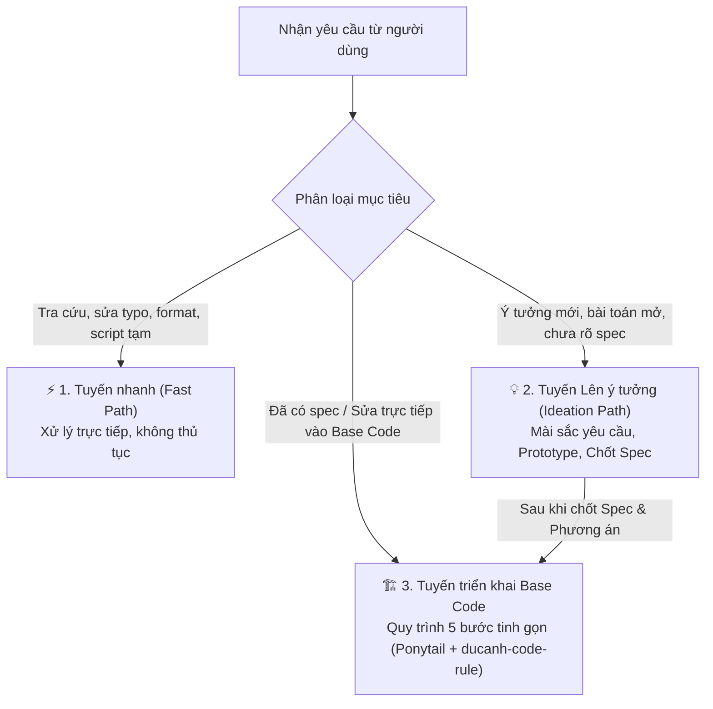

# Project Coding & Ideation Workflow

Quy trình chuẩn hóa toàn diện từ lúc **thai nghén ý tưởng** đến khi **viết code vào base code dự án**. Luồng này phối hợp chặt chẽ giữa:
- **Tư duy kiến tạo & Thử thách ý tưởng:** [`grilling`](file:///C:/Users/anhnd/.gemini/config/skills/grilling/SKILL.md), [`domain-modeling`](file:///C:/Users/anhnd/.gemini/config/skills/domain-modeling/SKILL.md), [`prototype`](file:///C:/Users/anhnd/.gemini/config/skills/prototype/SKILL.md), [`to-spec`](file:///C:/Users/anhnd/.gemini/config/skills/to-spec/SKILL.md).
- **Tính kỷ luật của ECC & Triết lý Ponytail:** [`ponytail`](file:///C:/Users/anhnd/.gemini/config/skills/ponytail/SKILL.md) (Lazy Senior Dev - The shortest working diff).
- **Quy tắc làm việc cốt lõi:** [`ducanh-code-rule`](file:///C:/Users/anhnd/.gemini/config/skills/ducanh-code-rule/SKILL.md), [`verification-before-completion`](file:///C:/Users/anhnd/.gemini/config/skills/verification-before-completion/SKILL.md), [`memory-discipline`](file:///C:/Users/anhnd/.gemini/config/skills/memory-discipline/SKILL.md).

---

## 1. Cơ chế phân tầng tác vụ (3-Lane Routing)

---

## 2. Tuyến 1: ⚡ Tuyến nhanh (Fast Path)
* **Áp dụng cho:**
  * Giải đáp thắc mắc kỹ thuật, tra cứu cú pháp, giải thích luồng code.
  * Sửa lỗi chính tả (typo), đổi tên biến đơn lẻ không ảnh hưởng public API.
  * Sửa định dạng (formatting), dọn import thừa không thay đổi hành vi.
  * Chạy các script tạm (scratch), đo đạc nhanh hoặc kiểm tra trạng thái môi trường.
* **Hành động:** Thực hiện trực tiếp, ngắn gọn, dứt điểm ngay mà không cần qua các bước thủ tục.

---

## 3. Tuyến 2: 💡 Tuyến Lên ý tưởng & Mài sắc yêu cầu (Ideation & Discovery)
*Áp dụng khi người dùng có ý tưởng mới, bài toán kinh doanh mở, hoặc yêu cầu còn mơ hồ trước khi bắt tay vào code.*

1. **Khơi gợi & Thử thách ý tưởng (`grilling` / `/grill-me`):**
   * Đóng vai trò đối thoại phản biện (Relentless Interviewer) để bóc tách ý tưởng thành **Cây quyết định (Design Tree)**.
   * Đặt các câu hỏi trúng đích theo từng đợt (rounds) kèm câu trả lời khuyến nghị:
     * Đối tượng thụ hưởng (actor/user) là ai?
     * Luồng chính (happy path) và các trường hợp biên/ngoại lệ (edge cases: rớt mạng, retry, timeout, conflict)?
     * Các ranh giới phi chức năng: Tải dự kiến, bảo mật, thời gian đáp ứng?
2. **Mô hình hóa miền nghiệp vụ (`domain-modeling`):**
   * Thống nhất bảng thuật ngữ chung (Glossary), định hình các Thực thể (Entities), Giá trị (Value Objects), và ranh giới nghiệp vụ (Bounded Contexts) để tránh hiểu nhầm khi code.
3. **Thử nghiệm nhanh không ràng buộc (`prototype`):**
   * Dựng một bản mockup giao diện nhỏ, state model giả lập hoặc script thử nghiệm độc lập (throwaway prototype) để người dùng "sờ tận tay" và cảm nhận luồng xử lý trước khi quyết định đưa vào base code.
4. **Cô đọng thành đặc tả kỹ thuật (`to-spec`):**
   * Tổng hợp thành bản Spec chuẩn: **Problem Statement ➔ Solution ➔ Danh sách User Stories** rõ ràng, sẵn sàng chuyển sang giai đoạn code dự án.

---

## 4. Tuyến 3: 🏗️ Tuyến triển khai Base Code (5 Bước tinh gọn)
*Áp dụng khi đã có yêu cầu/spec rõ ràng và bắt đầu tác động vào mã nguồn dự án.*

### Bước 1: Khảo sát & Tra cứu bộ nhớ (Context & Recall)
* **Tra cứu trí nhớ chia sẻ (`recall`):** Kiểm tra Agent Memory xem dự án đã có quyết định kiến trúc, quy ước đặt tên hay lưu ý đặc biệt nào chưa.
* **Đọc codebase trước khi sửa:**
  * Lần theo luồng thực tế từ Controller/Entrypoint ➔ Service ➔ Repository ➔ Database/Client.
  * Đọc các callers liên quan để đánh giá phạm vi ảnh hưởng (impact analysis).

### Bước 2: Thiết kế giải pháp & Đề xuất phê duyệt (Design & Propose)
* **Triết lý Ponytail & Tái sử dụng (`ponytail` + `ducanh-code-rule`):**
  * Tư duy "Lazy Senior Dev": Dòng code tốt nhất là dòng code không cần viết.
  * Kiểm tra xem repo đã có sẵn helper, service, component hay DTO tương đương chưa. Tuyệt đối không tạo class/hàm mới nếu code có sẵn tái sử dụng được.
  * Loại bỏ mọi tính năng dự phòng, boilerplate, generic trừu tượng "để dành cho tương lai" mà không ai yêu cầu.
* **Tối ưu hóa Database & Query từ sớm (`sql-query-tuning`):**
  * Nếu tác vụ có truy vấn dữ liệu: Xác định trước các điểm có nguy cơ N+1 query để dùng `JOIN FETCH` / `IN (:ids)` / batching ngay từ thiết kế.
  * Kiểm tra xem các trường filter/join đã có Index phù hợp chưa; ưu tiên Keyset Pagination nếu dữ liệu lớn.
* **Nguyên tắc "Đề xuất trước khi đổi logic":**
  * Nếu giải pháp tác động tới nghiệp vụ, luồng async, transaction, locking, validation: **Phải trình bày vấn đề, phương án, phạm vi, ưu/nhược điểm và rủi ro cho người dùng phê duyệt** trước khi bắt tay viết code.
  * Chỉ sửa đúng phạm vi đã chốt, không tự ý mở rộng scope.

### Bước 3: Triển khai tinh gọn (The Smallest Complete Change)
* **The Shortest Working Diff:**
  * Chọn cách triển khai nhỏ nhất, ít bước, ít query trung gian nhất.
  * Ưu tiên xử lý gọn tại SQL/Repository (`sql-query-tuning`); không kéo dữ liệu thô về rồi gom loop Java phức tạp.
  * Giữ Transaction ngắn nhất có thể: không gọi HTTP/API hay gửi mail bên trong DB Transaction.
  * Package đúng trách nhiệm (`domain.<feature>.controller`, `.service`, `.repository`,...).
* **Chính sách về Kiểm thử (Test):**
  * **Chỉ viết test khi người dùng yêu cầu rõ ràng** (theo tôn chỉ của `ducanh-code-rule`). Không tự tiện sinh test class hay sửa test cũ khi không được chỉ định.

### Bước 4: Tự rà soát & Kiểm chứng bằng chứng (Review, Security & Verification)
* **Rà soát chất lượng & Tinh gọn (`ponytail-review`):**
  * Đánh giá theo thứ tự: Đúng logic ➔ An toàn (transaction, deadlock) ➔ Chịu tải tốt ➔ Tinh gọn (Lean - xóa code thừa, không import bừa bãi).
* **Quét lỗ hổng bảo mật (`security-audit`):**
  * **SQL Injection:** 100% câu lệnh SQL phải dùng bind parameter, tuyệt đối cấm nối chuỗi.
  * **BOLA / IDOR:** Kiểm tra quyền sở hữu đối tượng (`AND user_id = :currentUserId`), không cho phép xem/sửa trộm dữ liệu người khác.
  * **Secrets & Logs:** Không hardcode API key, không ghi log mật khẩu/token/thẻ tín dụng thô.
* **Bằng chứng trước khi công bố (`verification-before-completion`):**
  * Chạy lệnh build / compile thực tế của dự án (`mvn test-compile`, `mvn compile`, `gradle build -x test`,...).
  * Chỉ khi lệnh kiểm tra trả về thành công (exit code 0) mới kết luận đã hoàn thành tác vụ.

### Bước 5: Chuẩn hóa Commit & Lưu giữ tri thức (Commit & Housekeeping)
* **Viết Commit chuẩn quốc tế (`conventional-commits`):**
  * Soạn Git Commit Message theo chuẩn Conventional Commits: `<type>(<scope>): <mô tả ngắn bằng thể mệnh lệnh>`. Ví dụ: `feat(order): add idempotency key for checkout`.
  * Tuân thủ tính nguyên tử: 1 commit cho 1 thay đổi logic trọn vẹn.
* **Lưu tri thức (`remember`):**
  * Nếu trong quá trình làm việc phát hiện ra một gotcha (bẫy kỹ thuật), quy ước ngầm của codebase hoặc quyết định được người dùng phê duyệt, lưu ngắn gọn vào Agent Memory để dùng chung cho các phiên làm việc sau.

